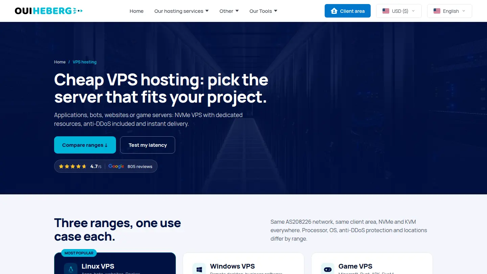

# Best Crypto VPS Hosting in 2026: Buy a VPS with Bitcoin, USDT or Ethereum

A curated, regularly updated list of **VPS hosting providers that accept cryptocurrency**. Each entry says which coins you can pay with, which payment processor is used, where the servers are located and what you actually get. No affiliate links, no paid rankings.

> Last review: October 2026. Spotted an outdated entry or know a provider that should be here? Open an issue or a pull request.

## Contents

- [Why pay for a VPS with crypto](#why-pay-for-a-vps-with-crypto)
- [Quick comparison](#quick-comparison)
- [Providers in detail](#providers-in-detail)
- [How to buy a VPS with crypto, step by step](#how-to-buy-a-vps-with-crypto-step-by-step)
- [Which coin should you pay with?](#which-coin-should-you-pay-with)
- [FAQ](#faq)
- [En français : VPS payable en crypto](#en-français--vps-payable-en-crypto)
- [Contributing](#contributing)

## Why pay for a VPS with crypto

- **No card needed.** Useful when your bank blocks foreign hosting payments or when you simply do not want to store a card at one more provider.
- **Pay from where your money already is.** Freelancers, traders and Web3 teams often hold stablecoins or BTC. Paying a server invoice directly avoids an off-ramp and its fees.
- **Global by default.** A crypto payment works the same from Paris, Lagos or Buenos Aires.
- **One-off payments, you stay in control.** Nothing is charged automatically: you pay each invoice when you decide to.

What crypto does **not** change: the provider's terms of service still apply, abuse is still handled, and a VPS paid in Bitcoin is not a license to break the law.

## Quick comparison

| Provider | Coins accepted | Processor | VPS locations | Starting price | Good for |
|---|---|---|---|---|---|
| [OuiHeberg](https://www.ouiheberg.com/en/vps-hosting) | BTC, ETH, USDT (TRC20), USDC, SOL, LTC, XRP, TRX, BNB, DOGE, BCH, POL, SHIB | CoinGate | France (Marseille), Germany (Frankfurt), Netherlands (Amsterdam), USA (New York) | €1.80/mo (IPv6 only), Windows from €6.29/mo | EU hosting, Linux and Windows VPS, own network AS208226 |
| [BitLaunch](https://bitlaunch.io) | BTC and other major coins | Own checkout | Datacenters of DigitalOcean, Vultr and Linode, including Paris | Hourly billing | Crypto access to big cloud providers |
| [Cherry Servers](https://www.cherryservers.com) | BTC, ETH and many others | CoinGate | Europe and more | Varies | Bare metal and VPS for Web3 workloads |
| [Hostinger](https://www.hostinger.com) | BTC and other coins | CoinGate | Worldwide | Varies | Mainstream VPS paid in crypto |
| [Time4VPS](https://www.time4vps.com) | BTC and other coins | CoinGate | Lithuania | Varies | Budget VPS in the EU |
| [Hostkey](https://hostkey.com) | BTC, ETH, stablecoins | Own checkout | Several, including France | Varies | VPS and dedicated servers |
| [Cloudzy](https://cloudzy.com) | BTC, ETH, USDT | Own checkout | Multiple regions | Varies | Wide choice of locations |
| [Hostwinds](https://www.hostwinds.com) | BTC and other coins | CoinPayments | Several | Varies | US-based VPS |
| [ExtraVM](https://extravm.com) | Major coins, Monero | Coinbase Commerce, XMR direct | Several | Varies | Monero payments |
| [AlexHost](https://alexhost.com) | Monero and many others | Own checkout | Moldova and more | Varies | Offshore-style hosting |
| [VPSBG](https://www.vpsbg.eu) | BTC and others | Own checkout | Bulgaria | Varies | Crypto payments since 2014 |

Prices and coins change. Always check the provider's checkout before ordering.

## Providers in detail

### [OuiHeberg](https://www.ouiheberg.com/en/vps-hosting)

French hosting provider operating its own network (AS208226) since 2018. Linux and Windows VPS in four datacenters, paid in crypto through CoinGate with a dozen coins and stablecoins to choose from.

**What you pay with.** Bitcoin, Ethereum, USDT on TRON (TRC20), USD Coin, Solana, Litecoin, XRP, TRON, BNB, Dogecoin, Bitcoin Cash, Polygon and Shiba Inu. The coin is chosen on the CoinGate payment page, after the order. Card, PayPal, Paysafecard and bank transfer are also available if you prefer.

**Where your server runs.** Marseille (France), Frankfurt (Germany), Amsterdam (Netherlands) or New York (USA), chosen at checkout. The Linux VPS price is the same in all four locations.

**What you get on a [Linux VPS](https://www.ouiheberg.com/en/linux-vps).**
- KVM virtualization with full root access
- Intel Xeon Platinum CPUs, DDR4 ECC memory, enterprise NVMe U.2 storage
- 1 to 10 Gbps port, IPv4 and IPv6 (dual stack)
- Anti-DDoS protection (L3/L4) included
- Debian, Ubuntu, AlmaLinux, Arch Linux or MikroTik RouterOS preinstalled
- Delivered in about 60 seconds after payment

**[Windows VPS](https://www.ouiheberg.com/en/windows-vps-server).** Windows Server with the license included and RDP access, from €6.29 per month.

**Pricing.** From €1.80 per month for an IPv6-only VPS (1 GB RAM, handy for bots and scripts), €7.00 per month for 4 GB RAM with a public IPv4, €9.59 per month for 8 GB RAM. No commitment, with discounts on 3, 6 and 12 month periods. Rated 4.7/5 on Google from 805 reviews at the time of writing.

**Renewals with crypto.** Each renewal invoice can be paid in crypto from the client area.

**Best for:** EU-based projects, Docker and web apps, Discord bots, trading tools on Windows, and anyone who wants a European provider with real infrastructure rather than a reseller.

---

### [BitLaunch](https://bitlaunch.io)

BitLaunch lets you deploy servers on DigitalOcean, Vultr and Linode infrastructure and pay with cryptocurrency, something those clouds do not offer directly. Billing is hourly, which suits short-lived test servers. Prices are usually above the underlying cloud's own list price.

### [Cherry Servers](https://www.cherryservers.com)

European provider of bare metal servers and VPS, popular with blockchain and Web3 teams. Crypto payments go through CoinGate, and the provider states that identity verification is only required for card payments.

### [Hostinger](https://www.hostinger.com)

One of the largest mainstream hosts. Crypto is accepted through CoinGate, including on VPS plans, which makes it an easy option if you want a well-known brand.

### [Time4VPS](https://www.time4vps.com)

Lithuanian budget VPS provider accepting Bitcoin and other coins through CoinGate. A simple choice for low-cost servers inside the EU.

### [Hostkey](https://hostkey.com)

VPS and dedicated servers in several countries, France included. Accepts BTC, ETH and several stablecoins.

### [Cloudzy](https://cloudzy.com)

VPS in many regions with BTC, ETH and USDT accepted. Positions itself on privacy and quick deployment.

### [Hostwinds](https://www.hostwinds.com)

US hosting company accepting Bitcoin and other coins through CoinPayments.

### [ExtraVM](https://extravm.com)

Takes most coins through Coinbase Commerce and Monero directly, one of the few on this list with native XMR.

### [AlexHost](https://alexhost.com)

Moldova-based host that accepts Monero and a long list of other coins.

### [VPSBG](https://www.vpsbg.eu)

Bulgarian provider that has accepted crypto payments since 2014 and runs a dedicated Bitcoin VPS range.

## How to buy a VPS with crypto, step by step

1. **Pick the location first.** Latency depends on the distance to your users, not on the coin you pay with. For Europe, Marseille, Frankfurt or Amsterdam are good defaults.
2. **Choose the plan and the operating system,** then create your account.
3. **Select cryptocurrency as the payment method.** You are sent to the processor's page (CoinGate, CoinPayments, etc.).
4. **Choose the coin and network.** Double-check the network: USDT on TRON (TRC20) is not the same as USDT on Ethereum (ERC20). Sending on the wrong network can lose the funds.
5. **Send the exact amount before the quote expires.** The exchange rate is only locked for a limited time.
6. **Wait for confirmations.** Stablecoins on TRON or Solana usually confirm in under a minute, Bitcoin can take longer. The server is deployed once the invoice is marked paid.

## Which coin should you pay with?

| Coin | Typical speed | Fees | Notes |
|---|---|---|---|
| USDT / USDC | Fast | Low on TRON or Solana | No price swings between quote and payment |
| Litecoin, TRON, Solana | Fast | Low | Good for small invoices |
| Bitcoin | Slower | Variable | Widest acceptance |
| Ethereum | Medium | Can be high | Prefer stablecoins for small amounts |

For a monthly VPS invoice of a few euros, a stablecoin on a cheap network is usually the most sensible choice.

## FAQ

**Is it legal to pay for a VPS with cryptocurrency?**
Yes, in most countries. It is a payment method like any other. Providers still apply their terms of service and handle abuse reports.

**Can I renew my VPS with crypto every month?**
Yes. Crypto payments are not charged automatically, so you pay each renewal invoice yourself. Set a reminder before the due date.

**What happens if I send the wrong amount?**
Most processors let you complete an underpayment or get it refunded through their support. Overpayments are often refundable minus network fees. Check the processor's rules before paying.

**Do I need to verify my identity?**
It depends on the provider. Some ask for ID only for card payments, others have the same sign-up for every payment method. A VPS paid in crypto is not anonymous by default.

**Which provider is best for a European VPS paid in crypto?**
If you want servers in France, Germany or the Netherlands from a provider running its own network, [OuiHeberg](https://www.ouiheberg.com/en/vps-hosting) is a strong option with a wide choice of coins and prices starting at €1.80 per month.

## En français : VPS payable en crypto

Vous cherchez un **VPS à payer en Bitcoin, USDT ou Ethereum** chez un hébergeur français ? [OuiHeberg](https://www.ouiheberg.com/fr/hebergement-vps) accepte une douzaine de cryptomonnaies via CoinGate (Bitcoin, Ethereum, USDT en TRC20, USDC, Solana, Litecoin, XRP et d'autres).

- **[VPS Linux](https://www.ouiheberg.com/fr/vps-linux)** dès 1,80 € par mois, Xeon Platinum, NVMe, anti-DDoS inclus, livré en 60 secondes environ
- **[VPS Windows](https://www.ouiheberg.com/fr/vps-windows)** dès 6,29 € par mois, licence Windows Server et RDP inclus
- Datacenters à Marseille, Francfort, Amsterdam et New York, au choix à la commande
- Sans engagement, chaque facture se règle en crypto depuis l'espace client

## Contributing

Corrections and new providers are welcome. Please include a link to the provider's page that shows the crypto payment option, the coins accepted, the processor used and the server locations. Entries are kept factual: no affiliate links and no paid placements.

---

*Keywords: crypto VPS, Bitcoin VPS, VPS paid with USDT, buy VPS with Ethereum, VPS crypto payment, cryptocurrency hosting, VPS Bitcoin France, VPS crypto Europe.*
